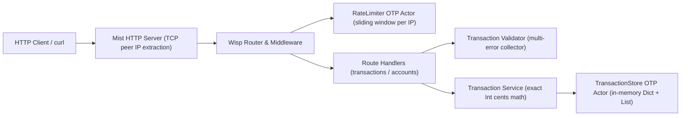

# 🏦 Homework 1: Banking Transactions API (Gleam + Wisp on Erlang BEAM)

> **Student / Author:** Vasyl Shtyk (`ShtykV`)  
> **Date Submitted:** 2026-11-26  
> **Tech Stack:** Gleam 1.19.2 · Erlang/OTP 29 (BEAM) · Wisp 2.2 · Mist 6.0 · `gleam_otp` · `gleam_time` · `gleeunit`  
> **AI Tools Used:** Antigravity Agent (Gemini 4 Neon) with Superpowers workflow skills (`brainstorming`, `writing-plans`, `executing-plans`, `test-driven-development`)

---

## 📋 Project Overview

A minimal, concurrent, type-safe REST API for banking transactions implemented in **Gleam** on the **Erlang BEAM** virtual machine. Choosing Gleam — a completely unfamiliar functional language for this exercise — served as a hands-on stress test of how effectively AI coding assistants accelerate onboarding into a modern, strongly typed ecosystem.

### Implemented Features
- **Task 1 — Core REST API:**
  - `POST /transactions` — Create a transaction (`201 Created`) with auto-generated `TXN-...` ID, UTC ISO 8601 timestamp, and default `completed` status.
  - `GET /transactions` — List transactions sorted newest-first (`200 OK`).
  - `GET /transactions/:id` — Retrieve a transaction by ID (`200 OK` / `404 Not Found`).
  - `GET /accounts/:accountId/balance` — Compute multi-currency account balances (`200 OK` / `400 Bad Request` / `404 Not Found`) with optional `?currency=USD` filter.
  - `GET /health` — Lightweight healthcheck endpoint (`200 OK`).
- **Task 2 — Multi-Error Transaction Validation:**
  - Positive numeric `amount` with at most 2 decimal places (rejects `0`, negatives, >2 decimals, strings, and booleans).
  - Strict `ACC-XXXXX` (5 ASCII alphanumeric characters) account validation in request payloads, path parameters, and query parameters.
  - Full active **ISO 4217** currency code validation (O(1) BEAM jump-table pattern match).
  - Type-specific account rules (`deposit` requires `toAccount`, `withdrawal` requires `fromAccount`, `transfer` requires both and rejects self-transfers).
  - Collects **all** invalid fields into a single `400 Bad Request` response matching the exact contract from `TASKS.md`.
- **Task 3 — Transaction History Filtering:**
  - Combinable query filters on `GET /transactions`: `?accountId=`, `?type=`, `?from=`, `?to=`.
  - Supports both date-only (`YYYY-MM-DD`, expanded inclusively across the full UTC day `00:00:00Z`–`23:59:59.999999999Z`) and full RFC 3339 / ISO 8601 timestamps, rejecting invalid dates or inverted ranges (`from > to`).
- **Task 4 (Option D) — Sliding-Window Rate Limiting:**
  - Per-IP sliding-window rate limiter defaulting to **100 requests / 60 seconds** (configurable via `RATE_LIMIT_REQUESTS` and `RATE_LIMIT_WINDOW_SECONDS`).
  - Emits `X-RateLimit-Limit`, `X-RateLimit-Remaining`, and `X-RateLimit-Reset` headers on every response; returns `429 Too Many Requests` with `Retry-After` and a structured JSON body when exceeded.

---

## 🏗️ Architecture & Key Design Decisions



1. **Zero-Mutation Concurrency with Type-Safe OTP Actors (`gleam/otp/actor`):**  
   Because Gleam has no mutable global variables, both the in-memory transaction store (`storage/transaction_store.gleam`) and the sliding-window rate limiter (`middleware/rate_limiter.gleam`) run as dedicated BEAM OTP Actors. Requests interact with them through typed message protocols (`process.call`), eliminating race conditions without locks or Erlang FFI.
2. **Exact Monetary Arithmetic with Integer Minor Units (`Int` cents):**  
   BEAM integers have arbitrary precision. Storing amounts internally as `Int` cents guarantees exact balance summation (`0.10 + 0.20 = 0.30`, never `0.30000000000000004`) while serializing cleanly to JSON numbers.
3. **Multi-Currency Balances & Overdraft Rules:**  
   `GET /accounts/:accountId/balance` returns balances grouped by currency (`balances: {"EUR": 500.0, "USD": 1028.5}`) so distinct currencies are never improperly added together. Overdraft (negative balance) is permitted so sample transfer requests work out of the box on an empty store. Only `completed` transactions affect numeric balances; `pending` and `failed` transactions remain queryable and establish account existence (`0.0` balance rather than `404`).
4. **Mist-to-Wisp Client IP Forwarding:**  
   A thin wrapper around `wisp_mist.handler` extracts the peer IP via `mist.get_connection_info` and sets `x-client-ip` when `X-Forwarded-For` is absent. This makes the rate limiter work seamlessly both over live TCP sockets and in socket-free `wisp/simulate` tests.
5. **Opt-In Demo Seeding:**  
   The server starts with an empty store by default (`gleam run`), while `SEED_DATA=true` (enabled in `demo/run.bat` and `demo/run.sh`) seeds 7 multi-currency transactions from `demo/sample-data.json`.

### Project Structure

```text
homework-1/
├── gleam.toml                          # Project manifest & Hex dependencies
├── manifest.toml                       # Locked dependency versions
├── .gitignore                          # Excludes build/, *.beam, .env, logs
├── README.md                           # Architecture, API reference & AI usage log
├── HOWTORUN.md                         # Reproducible setup, run & test guide
├── src/
│   ├── banking_api.gleam               # Mist server entrypoint & env configuration
│   └── banking_api/
│       ├── context.gleam               # Dependency container (store, limiter, clock)
│       ├── router.gleam                # Wisp routing & middleware pipeline
│       ├── models/transaction.gleam    # Domain ADTs, cents conversion & JSON codecs
│       ├── validators/transaction_validator.gleam  # Multi-error payload & filter validation
│       ├── storage/transaction_store.gleam         # OTP Actor in-memory store
│       ├── services/transaction_service.gleam      # Business logic, filtering & balances
│       ├── middleware/rate_limiter.gleam           # OTP Actor sliding-window rate limiter
│       ├── routes/
│       │   ├── transactions.gleam      # POST/GET /transactions, GET /transactions/:id
│       │   └── accounts.gleam          # GET /accounts/:accountId/balance
│       └── utils/currencies.gleam      # Active ISO 4217 code lookup
├── test/                               # 25 unit & wisp/simulate HTTP tests (gleeunit)
├── demo/                               # run.bat, run.sh, sample-requests.*, sample-data.json
└── docs/screenshots/                   # Visual verification screenshots
```

---

## 📡 API Reference

| Method | Endpoint | Success | Error Codes | Description |
|---|---|---|---|---|
| `GET` | `/health` | `200 OK` | `429` | Health check (`{"status":"ok"}`) |
| `POST` | `/transactions` | `201 Created` | `400`, `429` | Validate and create a transaction |
| `GET` | `/transactions` | `200 OK` | `400`, `429` | List transactions (`?accountId=&type=&from=&to=`) |
| `GET` | `/transactions/:id` | `200 OK` | `404`, `429` | Fetch a single transaction by ID |
| `GET` | `/accounts/:accountId/balance` | `200 OK` | `400`, `404`, `429` | Multi-currency account balance (`?currency=USD`) |

### Example Validation Error (`400 Bad Request`)
```json
{
  "error": "Validation failed",
  "details": [
    {"field": "amount", "message": "Amount must be a positive number"},
    {"field": "currency", "message": "Invalid ISO 4217 currency code"},
    {"field": "fromAccount", "message": "Account number must follow format ACC-XXXXX (5 alphanumeric characters)"}
  ]
}
```

### Example Rate Limit Exceeded (`429 Too Many Requests`)
Headers: `X-RateLimit-Limit: 100`, `X-RateLimit-Remaining: 0`, `X-RateLimit-Reset: <epoch>`, `Retry-After: <seconds>`
```json
{
  "error": "Too Many Requests",
  "message": "Rate limit exceeded. Maximum 100 requests per 60 seconds."
}
```

---

## 🤖 AI Usage Documentation

### Workflow & Prompting Strategy
Development followed a structured AI-assisted workflow instead of one-shot code generation:

1. **Requirements Brief & Design Alignment:**  
   - *Initial prompt:* Asked the assistant to read `homework-1/TASKS.md` and `AGENTS.md`, run a short clarifying brief on stack, Task 4 choice, balance logic, edge cases, and demo/test requirements before writing any code.
   - *Outcome:* Locked down multi-currency balances, overdraft policy, unknown account `404`, opt-in `SEED_DATA=true`, and Task 4 Option D (Rate Limiting).
2. **Ecosystem Exploration Pivot (Python → Gleam + Wisp):**  
   - *Prompt:* Asked what modern, unfamiliar tech stacks exist to intentionally step outside familiar tools.
   - *Outcome:* Evaluated Rust/Axum, Go/`net/http`, Elixir/Bandit, Gleam/Wisp, Bun/Hono, and Zig; chose **Gleam + Wisp + Mist on Erlang BEAM**.
3. **Spec-Driven Planning & Strict TDD Implementation:**  
   - Produced a written design spec and a 6-task TDD plan with explicit module interfaces and 5 high-risk edge-case classes (*Review Focus*).
   - Executed task-by-task in strict **RED → GREEN** cycles (`validator_test`, `service_test`, `rate_limiter_test`, `api_test`), verifying compiler failures before implementing each module and committing incrementally.

### Challenges Encountered & How AI + Verification Solved Them
| Challenge | What Happened | Resolution & Verification |
|---|---|---|
| **Windows `winget` Erlang installer hang** | `winget install Erlang.ErlangOTP` hung silently without displaying a UAC prompt in headless execution. | Switched to official GitHub Releases portable ZIP archives (`otp_win64_29.1.3.zip` and `gleam-v1.19.2-x86_64-pc-windows-msvc.zip`) extracted to `%LOCALAPPDATA%\Programs` — zero UAC required and documented in `HOWTORUN.md`. |
| **Missing `rebar3.cmd` on Windows** | Compiling `mist`'s transitive Erlang dependency `hpack_erl` failed with `Program not found: rebar3.cmd`. | Installed official `rebar3` escript with a 2-line `rebar3.cmd` wrapper in Erlang's `bin/` directory; verified clean compile (`Compiled in 2.66s`). |
| **Gleam package API version drift** | General web examples referenced older `gleam_time` (`timestamp.now`), `mist.start_http`, and `actor.call` signatures. | Inspected the actual installed source files under `build/packages/` (`wisp v2.2.2`, `mist v6.0.3`, `gleam_otp v1.3.0`, `gleam_time v1.11.0`) to use exact current APIs (`timestamp.system_time`, `mist.start`, `process.call`, `use <- wisp.log_request`). |
| **Gleam type vs constructor imports** | `test/validator_test.gleam` failed to compile because `ValidationError` imported only the value constructor, not the type. | Fixed with `type ValidationError` syntax caught immediately by the Gleam compiler. |

### Manual & Automated Verification Performed
- **Automated suite (`gleam test`):** 25/25 unit and `wisp/simulate` HTTP integration tests passing in ~0.3s with zero compiler warnings.
- **Live Mist HTTP verification:** Booted the real Mist server on port `3000` with `SEED_DATA=true` and `RATE_LIMIT_REQUESTS=8`, verified `GET /health`, `POST /transactions` (`201`), `GET /transactions/:id` (`200`), combined filtered `GET /transactions`, multi-currency `GET /accounts/ACC-12345/balance` (`{"EUR": 500.0, "USD": 1028.5}`), multi-field `400 Validation failed`, unknown account `404`, and `429 Too Many Requests` with `Retry-After` on the 9th request.

---

## 📸 Screenshots

Visual verification captures are stored in [`docs/screenshots/`](docs/screenshots/):
- [`docs/screenshots/api-running.png`](docs/screenshots/api-running.png) — Live Mist + Wisp server startup with `SEED_DATA=true` and incoming request logs
- [`docs/screenshots/api-requests-responses.png`](docs/screenshots/api-requests-responses.png) — Live `POST /transactions`, `GET /transactions/:id`, filtered `GET /transactions`, and multi-currency `GET /accounts/:accountId/balance`
- [`docs/screenshots/validation-and-rate-limit.png`](docs/screenshots/validation-and-rate-limit.png) — Structured `400 Validation failed`, `404 Not found`, and `429 Too Many Requests` with `X-RateLimit-*` and `Retry-After` headers
- [`docs/screenshots/tests-passing.png`](docs/screenshots/tests-passing.png) — Full `gleam test` suite passing (25/25 tests, 0 warnings)

---

<div align="center">

*Completed by Vasyl Shtyk as part of the GenAI and Agentic AI for Software Engineering course.*

</div>
